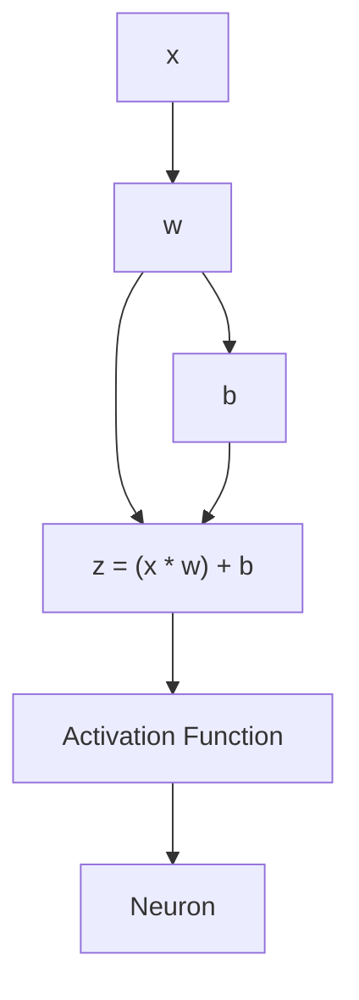
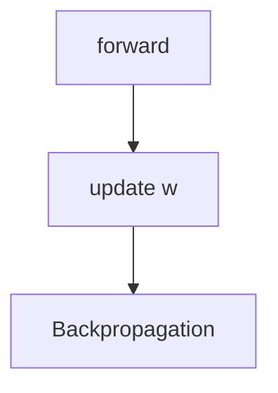
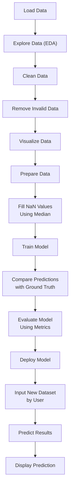

# deep_learning
# 16/9 EX-LT01 và Lab01: Đọc báo về học sâu và làm quen với pytorch
### ngày đầu tiên được học về học sâu , được xét những gì đã đọc của tác giả yannLecun thì học sâu nó khác học máy ở nhiều chỗ so với học máy (cần được học hiểu nhiều hơn)
+ Đưa bài toán đời thực vào code thì phải viết cả trăm cái quy tắc răng đe mà chưa chắc đúng
+ Học máy thì cho máy tính học bài toán thực tế theo mô hình với nhiều tham số chỉnh sửa
+ Học sâu 1 sự khác biệt lớn là máy tính nó lại tự học bằng đặc trưng (rất là đáng chú ý)
+ Nhiều từ chú ý : neuron , percontron , hàm kích hoạt , trọng số và bias
+ Thấy học sâu nó sài nhiều với cái pytorch , pytorch nó dùng thư viện tensor , mảng đa chiều đại diện cho tham số và dữ liệu trong mạng nơ ron sâu
+ Cảm giác cái tensor nó giống cục rubic , 1 dim thì 1 ma trận dãy giá trị , 2 dim là một cái mặt màu của cục rubic , 3 dim là 1 cái khối 3 màu ở góc cục rubic , 4 dim là 2 cục rubic (khó hiểu quá)
  
# 24/9 Bài tập 1: hồi quy tuyến tính
+ Hồi quy là phương pháp mô hình hóa quan hệ giữa các biến/đặc trưng để có thể quyết định giá trị cho 1 biến/đặc trưng muốn tìm
+ Được kết hợp với đường tuyết tính trải dài qua tất cả kết quả dự đoán , để dùng các độ đo MSE RMSE để xét kết quả

# 12/10 Bài tập2: hồi quy logistic và đồ thị tính toán 
+ Cũng như hồi quy tuyến tính , Logistic thì nó khác chỗ , tuyến tính thì nó dự đoán 1 giá trị bởi nhiều biến , logicstic thì bẻ cong cái đường tuyến tính thì cái chữ S để nó trả lời cho câu hỏi Yes or No
+ Được học thêm code vẽ đồ thị

# 28/10 bài tập 3: perceptron và mạng học sâu 
+ Lấy giá trị x nhân với trọng số W ta được đoạn thẳng tùy vào x hay trọng số mà nó thay đổi đường đi
+ x nhân trọng số rồi cộng thêm bias nữa thì đoạn thẳng có thể đi lên đi xuống trên trục
+ x nhân trọng số cộng bias và thêm hàm kích hoạt để bẻ công đường thẳng y =mx+b thì ra neuron

+ Nếu cho các lớp neuron học bởi lớp neuron khác và xếp chồng lên nhau thành nhiều tầng sẽ cho ra mạng học sâu
  
# 1/11 bài tập 4: MLP và mạng học sâu 
+ Mạng MLP có 3 bước tính toán chính

+ lặp lại trên nhiều epoch đã dần dần tự chỉnh sửa lại các trọng số là gradient descent rồi quy luật sẽ được học và rõ ràng hơn
  
# 23/9 Lab02: Quy trình máy học 
+ load data --> explore data --> clean data --> remove invalid data --> visualize --> prepare data --> fill nan bằng giá trị median --> train model --> so sánh mô hình với nhãn bằng độ đo --> triển khai với bộ dữ liệu mới tự nhập

# 29/10 M01 - batchGD regression

# 2/11 proposal và BTL01 funtion approximation

# 14/11 M02 - Mock_MLP

# 19/11 bài tập CNN và MLP + M03-SGD và RNN 

# 28/11 BTL02: nhận dạng cảm xúc

# 29/11 BTL03- chuyển code kerras sang pytorch 

